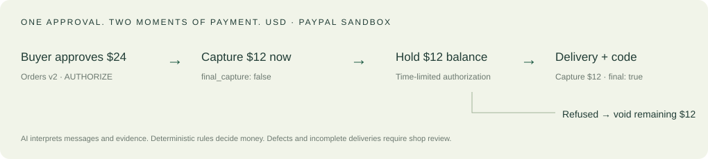

# Entrega Segura

**Fund the custom order now. Collect the balance on verified delivery.** A delivery-aware checkout prototype for Latin American shops that sell over WhatsApp, grounded in Pascal Studio's workflow in Ecuador.

**PayPal:** Orders v2 (`AUTHORIZE`), Payments v2 (partial/final capture, void, reauthorize, refund), webhook verification, and a Payouts adapter. **AI:** Spanish delivery-event extraction and message drafting; optional image interpretation and Whisper transcription. **Measured:** 22/24 correct text classifications (91.7%) on a small labelled set; see [the complete run](reports/ai-evaluation.json). Real sandbox order creation and API checks have run. **Buyer-approved partial/final capture and a real verified PayPal webhook are still awaiting end-to-end validation.**

PayPal calls are real **sandbox** calls. WhatsApp and courier updates are **simulated**. All orders and people are fictional. This is a working local prototype with explicitly unfinished payment-lifecycle verification, not a live payment product. No Pascal Studio source code is included here.

## What happens to the money · 30 seconds



For a fictional $24 hoodie, excluding shipping:

1. Buyer approves a $24 authorization in PayPal Sandbox.
2. Capture $12 for production with `final_capture: false`.
3. Keep the $12 balance authorized, within PayPal's time limits.
4. Delivered + matching four-digit code → capture $12 with `final_capture: true`.
5. Refused at the door → void the remaining authorization. The disclosed custom-production deposit is retained.

The intended benefit: buyers do not pay the balance without a confirmed delivery; shops can see an authorization before dispatching; nobody manually checks bank-transfer screenshots. A hold is **time-limited and can fail**. This is not escrow, insurance, or a guarantee of collection. Buyer rights and PayPal disputes still apply.

## Try it

**Local review first; no hosted URL yet.** The owner requested local testing before publication. Start the app below, then open:

- [Landing](http://localhost:3025)
- [Judge demo](http://localhost:3025/judge)
- [Shop panel](http://localhost:3025/tienda)

Start a journey → open **Approve in PayPal Sandbox** → sign in with a **sandbox personal buyer** and approve → return and select **I approved → Check & capture deposit**. Approval is never faked. A normal/live PayPal login does not work in sandbox. After the deposit is completed, send a message with the displayed delivery code or use a labelled courier-scenario button. Expand each API call for PayPal IDs, HTTP status, debug ID, and a response with personal fields redacted.

Start a separate order for refusal or another final outcome. For absence, use **Not home** twice; the second attempt asks the shop to review. For a defect, first complete delivery, then attach a fictional PNG/JPG/WebP image and describe the issue. A shop review and explicit refund amount are required. A photo claim alone never initiates a refund.

**Pascal integration:** a separate, private opt-in branch adds `http://localhost:3015/demo/entrega-segura`. Pascal's server creates an Entrega checkout using a shared API credential. The browser claims the checkout through an expiring signed URL. Pascal retrieves authoritative status server to server and validates timestamped HMAC callbacks. This proves an API connection to the private Pascal application; it does **not** connect to commercial orders or its production database. The private implementation is intentionally absent here; see [the public API contract](docs/integration.md).

## What's real vs simulated

| Component                                                                                      | Status                                                                                                                        |
| ---------------------------------------------------------------------------------------------- | ----------------------------------------------------------------------------------------------------------------------------- |
| PayPal OAuth, order creation, order retrieval, unapproved-order rejection, idempotent creation | Real sandbox; exercised                                                                                                       |
| Deposit/final captures, void, refunds, reauthorization                                         | Real API implementation; lifecycle requires sandbox buyer approval; mocked unit coverage is separately labelled               |
| PayPal webhook signatures                                                                      | Verification API implementation; no genuine `SUCCESS` event received locally yet; unit verification responses are mocked      |
| Payouts                                                                                        | Real sandbox adapter; not yet exercised against the account                                                                   |
| AI text parser and Spanish reply drafts                                                        | Real DeepInfra calls; measured 22/24                                                                                          |
| Photo input                                                                                    | Actual attachment sent to OpenAI vision; one fictional-illustration smoke check passed; outside the text accuracy measurement |
| Voice notes                                                                                    | Real OpenAI `whisper-1` call tested with a synthetic Spanish note; outside the text accuracy measurement                      |
| LAAR                                                                                           | `SimulatedLaar`; no access to LAAR's real API                                                                                 |
| WhatsApp                                                                                       | Browser simulator; no Meta/Kapso connection and no messages sent                                                              |
| Pascal                                                                                         | Local server-to-server integration with a private checkout; opt-in fixture orders; production untouched                       |
| Products and people                                                                            | Fictional orders using business-supplied prices and policies; no customer data                                                |

Courier events entered through the judge buttons are explicitly labelled simulated. A real deployment would need authenticated courier/customer evidence, merchant access control, dispute handling and operational reconciliation. The public demo is sandbox-only.

## PayPal APIs used

All requests are pinned to `https://api-m.sandbox.paypal.com`. A live environment is rejected.

| Endpoint                                            | Purpose                                                      |
| --------------------------------------------------- | ------------------------------------------------------------ |
| `POST /v1/oauth2/token`                             | Server-side client-credentials authentication                |
| `POST /v2/checkout/orders`                          | Create full-amount `AUTHORIZE` order                         |
| `GET /v2/checkout/orders/{id}`                      | Check actual approval and retrieve order                     |
| `POST /v2/checkout/orders/{id}/authorize`           | Authorize after buyer approval                               |
| `POST /v2/payments/authorizations/{id}/capture`     | Production deposit (`false`) or final balance (`true`)       |
| `GET /v2/payments/authorizations/{id}`              | Authorization evidence / sandbox probe                       |
| `POST /v2/payments/authorizations/{id}/void`        | Release remaining hold on refusal                            |
| `POST /v2/payments/authorizations/{id}/reauthorize` | Refresh eligible aged authorization                          |
| `GET /v2/payments/captures/{id}`                    | Reconcile capture state; pending is never shown as completed |
| `POST /v2/payments/captures/{id}/refund`            | Shop-approved partial refund, one intent per reservation     |
| `POST /v1/payments/payouts`                         | Courier/supplier payout adapter                              |
| `GET, POST /v1/notifications/webhooks`              | Find/register deployed webhook subscription                  |
| `POST /v1/notifications/verify-webhook-signature`   | Verify received event before processing                      |

`lib/paypal/` exports `hold`, `release`, `cancel`, `refund`, `payOut`, `status`, plus approval, reconciliation and reauthorization helpers. Every write includes a deterministic `PayPal-Request-Id`. Financial operations have a SQLite journal: successful results survive local restarts, amounts cannot change after an intent is recorded, and an unresolved operation older than six hours requires reconciliation rather than a blind retry. Calls record HTTP status and `paypal-debug-id`. The journal assumes one service instance and an intact store.

The usual honor period is three days; the original authorization life is at most 29 days. Reauthorization does not reset the original 29-day deadline. The final-capture path reauthorizes an eligible aged hold; expired holds stop and require new approval. Timer-driven reconciliation is not implemented. The shop can explicitly check/reauthorize from the demo.

**Partial-capture compatibility is not yet proven for this sandbox account.** The included probe is designed to verify it before presenting the full money journey as validated. If the account disallows multiple captures, a two-order fallback is still required; it is not silently simulated.

References: [PayPal authorize/delay capture](https://developer.paypal.com/checkout/delay-capture/), [Payments v2](https://developer.paypal.com/api/payments/v2/), [webhook verification](https://developer.paypal.com/api/rest/webhooks/rest/).

## AI used and how

- Text: DeepInfra `meta-llama/Llama-3.3-70B-Instruct` by default. OpenAI `gpt-4.1-mini` is available by setting `AI_PROVIDER=openai`. `AI_MODEL` overrides the text model.
- Photos: OpenAI `gpt-4.1-mini` by default (`AI_VISION_MODEL` override). Actual image content, message, and attachment presence go to the model. Use fictional evidence only.
- Voice: OpenAI `whisper-1`, Spanish transcription; the transcript is editable before submission to the parser.
- Output: a Zod-validated `DeliveryEvent` kind, a factual Spanish interpretation, and a draft reply in the **usted** tone. The model never receives payment credentials, never invokes payment APIs, and cannot invent a trusted delivery code. Code is extracted directly from the submitted message or from the explicitly simulated courier adapter.
- Money decisions: a pure deterministic gate verifies current payment state, matching delivery code, duplicate events, attempt counts, authorization age, and defect policy. Human review approves any refund. The UI shows the model interpretation alongside the separate rule decision.
- Development tool: OpenAI Codex assisted architecture, implementation, tests, UI and documentation. Generated code was checked locally; no invisible instructions to judges are included.

### Measured parser result

The first run scored **22/24 (91.7%)** at temperature 0. [Every input, expected label, output and error is available](reports/ai-evaluation.json). This is a small developer-authored text set, not an independent benchmark. It covers delivered, refusal, absence, incomplete delivery, defects, expiry, future/conditional language, greetings and prompt injection. Image/voice accuracy was not measured. Errors count as incorrect.

The two mistakes were “Todavía no me llega el pedido” and “No he recibido nada y nadie vino”: both expected `unknown`, predicted `not_home`. Neither can release money. Ambiguity is a reason to review, not evidence of a completed delivery. Do not infer production reliability from this small score.

## Run locally

Node **22.19+** (Node 22 or 24), npm, and a PayPal Sandbox REST application. SQLite uses Node's built-in `node:sqlite`; Node 22 may emit an experimental warning.

```sh
npm ci
cp .env.example .env
# Fill sandbox credentials, APP_URL=http://localhost:3025,
# STORE_DIR=./.data and a random SESSION_SECRET of at least 32 characters.
# Set DEEPINFRA_API_KEY and/or OPENAI_API_KEY for actual AI calls.
npm run dev
```

Generate local signing keys with `openssl rand -hex 32`. Keep all secrets in the ignored `.env`; never commit buyer passwords, API credentials, SQLite data or `.env` files. `.env.example` intentionally contains only variable names with empty values. `SHOP_API_KEY` and `SHOP_WEBHOOK_SECRET` are only needed for the Pascal integration; the keys must match Pascal's server configuration. `PASCAL_DEMO_URL` is a public navigation URL, not a secret.

```sh
npm run typecheck
npm test
npm run build
npm start
# Shut down a local server with Ctrl-C when testing ends.
```

### Sandbox compatibility probe

```sh
npm run sandbox:probe
# Open the printed approval URL and approve with the sandbox buyer.
npm run sandbox:probe -- ES-ORDER_REFERENCE_FROM_FIRST_COMMAND
```

The second command authorizes, captures the deposit, then captures the remaining balance. It prints actual IDs and `multiplePartialCaptureProven`. It never auto-approves an order. A buyer approval is required.

### Hosting later on Render

A `render.yaml` blueprint is included for a Next.js Node web service. Deployment is intentionally deferred until local review. Use `npm ci && npm run build` and `npm start`, configure secrets in Render, and set `APP_URL` to the final HTTPS origin. Do not use Vercel for this project.

The free Render filesystem is ephemeral. That is suitable only for a disposable sandbox demo; restart/redeploy can erase the ledger. For a durable demonstration, the owner must choose a service with a persistent disk, mount it, and set `STORE_DIR` to that mount. Do not treat the free ephemeral store as a reliable payment ledger. Run exactly one instance.

After hosting and durable-store configuration:

```sh
# APP_URL must be the deployed HTTPS origin.
npm run webhook:register
# Transfer the resulting PAYPAL_WEBHOOK_ID into the hosted environment.
```

This registers the sandbox app's webhook and appends its ID to the ignored local `.env`. Configure the hosted environment separately. Localhost cannot receive genuine PayPal callbacks without an explicitly configured HTTPS tunnel. A simulated webhook is never reported as real verification success. See [Render's Next.js instructions](https://render.com/docs/deploy-nextjs-app).

## Architecture

```text
Pascal server (private) ── authenticated API ──→ Entrega Segura (public code)
       ↑ signed callback + status lookup              │
Buyer/courier chat → AI parser → typed event → deterministic gate
                                                     │
                                     PayPal module → real Sandbox
                                                     │
                                        verified webhook → ledger
```

- `app/`: landing, `/judge`, `/tienda`, server APIs, same-origin writes, signed HttpOnly guest sessions.
- `lib/gate/`: pure business rules; never calls the model or network.
- `lib/paypal/`: sandbox client, stable request IDs, operation journal, capture/refund/void/reauthorization, webhook verification.
- `lib/courier/`: ready-to-replace courier interface; labelled simulated LAAR and chat-code adapters.
- `lib/ai/`: validated extraction, Spanish drafts, optional vision/Whisper.
- `lib/store.ts`: SQLite WAL, reservations, operation intents, webhook deduplication by transmission and event ID, callback outbox. Single service process only.
- `lib/orders.ts`: event processing and retry, explicit shop refund review, timestamped HMAC integration callbacks. Queued callbacks retry on later notifications or an explicit retry action; there is no background delivery worker yet.

No private Pascal implementation or production secrets are needed to run the independent demo. Shop panel access is scoped to the current judge session; it is not a production merchant admin system.

## Tests

```sh
npm test                       # deterministic unit/property tests; sandbox tests skipped
npm run test:sandbox            # loads .env; includes real PayPal sandbox checks
npm run eval:ai                 # live model calls; writes the full accuracy report
node --env-file=.env node_modules/tsx/dist/cli.mjs scripts/verify-local.ts
# Last command needs both local applications running with matching integration secrets.
```

The sandbox suite has **eight real-API checks**: token, actual AUTHORIZE order, amount, direct PayPal create replay, unapproved authorization rejection, invalid authorization, webhook subscriptions, and an independent second order. These checks do **not** prove settlement. Three additional lifecycle checks require `SANDBOX_APPROVED_ORDER_ID` set to a locally stored reservation reference whose buyer has already approved. They remain skipped until that approval exists.

Unit tests cover payment actions with an explicitly mocked PayPal transport, including concurrent release, pending deposit, repeated refund, aged and expired authorization, retry after a network-side error, forged webhook rejection, duplicate webhook delivery, and out-of-order authorization events. Gate property tests exercise thousands of generated cases, including wrong codes and resolved balances.

[Local API-contract evidence](reports/local-contract.json) records the connection between the two local applications, guest ownership, signed claim, cross-origin protection, authenticated/forged callbacks, and real AI parsing without charging an unapproved order. This is separate from PayPal webhook verification.

## License

[MIT](LICENSE). This repository contains newly implemented Entrega Segura code. Pascal Studio's private application remains private.

Additional evidence: [one synthetic voice-note check](reports/audio-smoke.json), [one fictional image-input check](reports/vision-smoke.json). These are functionality checks, not accuracy benchmarks.
